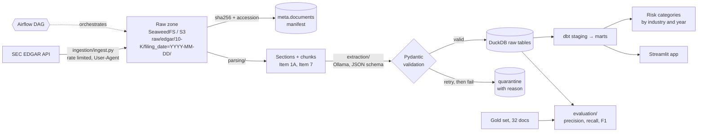

# SEC Filings Extraction Pipeline

Turns unstructured 10-K filings from SEC EDGAR into reliable, queryable tables using a local
open-source LLM, with validation, retries, a quarantine table and a measured evaluation.

**Status:** Stages 1-5 done (ingestion, parsing, extraction schema, LLM extraction, evaluation). See [PROGRESS.md](PROGRESS.md).

## Architecture



Boxes after the raw zone are planned and get built stage by stage.

## Quick start

Run these one at a time. (macOS ships `python3`, not `python`; inside the activated venv both work.)

1. Create `.env` and put your name and email in `SEC_USER_AGENT`:
   ```bash
   cp .env.example .env
   ```
2. Install:
   ```bash
   python3 -m venv .venv
   source .venv/bin/activate
   pip install -r requirements-dev.txt
   pytest -q
   ```
3. Start the local S3 server (file browser at http://localhost:8888):
   ```bash
   docker compose up -d
   ```
4. Ingest, then run again to prove idempotency (the second run downloads 0):
   ```bash
   python -m ingestion.ingest --tickers AAPL JPM --per-company 1
   python -m ingestion.ingest
   python -m ingestion.ingest
   python -m ingestion.summary
   ```
5. Parse every filing into sections and chunks, then check coverage:
   ```bash
   python -m parsing.parse
   python -m parsing.report
   ```
6. Extract with the local model (needs the Ollama app running and `ollama pull qwen3:8b`).
   Try a few filings first; the full run takes a while on a laptop and can be stopped and
   resumed at any time (finished tasks are skipped):
   ```bash
   python -m extraction.extract --limit 3
   python -m extraction.report
   python -m extraction.extract
   ```
7. Evaluate. The first command samples the gold set and pre-fills it from each filing's inline
   XBRL; check the rows by hand (rules in `evaluation/LABELLING.md`), then score:
   ```bash
   python -m evaluation.gold
   python -m evaluation.evaluate
   ```

## Repository layout

| Folder | Stage | Contents |
|---|---|---|
| `ingestion/` | 1 | EDGAR client, raw-zone storage, manifest, company list |
| `parsing/` | 2 | HTML to text, section finder, chunking |
| `extraction/` | 3, 4 | Pydantic schema, LLM client, retries, quarantine |
| `evaluation/` | 5 | XBRL reference values, gold set and labelling rules, metrics |
| `dbt/` | 6 | staging and marts on DuckDB |
| `dags/` | 7 | Airflow DAG |
| `app/` | 9 | Streamlit app |
| `tests/` | all | pytest, fully offline |

## Extraction schema

Defined in [`extraction/schema.py`](extraction/schema.py) with Pydantic. The model answers three
small tasks, each constrained to its own JSON schema; everything else comes from the manifest.

| Field | Type | Source | Rules |
|---|---|---|---|
| `cik` | 10-digit string | manifest | zero-padded |
| `ticker`, `company_name` | string | manifest | |
| `period_end`, `fiscal_year` | date, int | manifest (`reportDate`) | fiscal year = year the period ends |
| `revenue` | value + unit (+ quote) | LLM, Item 8 / 7 | value > 0; unit in units / thousands / millions / billions; `revenue_usd` computed in code |
| `net_income` | value + unit (+ quote) | LLM, Item 8 / 7 | may be negative; `net_income_usd` computed in code |
| `employee_count` | int (+ quote) | LLM, Item 1 | 1 to 5,000,000 |
| `risk_factors` | 1-8 × (title, category) | LLM, Item 1A | category from a fixed list of 11; duplicates dropped |
| `model`, `parser_version`, `schema_version`, `extracted_at` | provenance | pipeline | |

Risk categories: `market_competition`, `macroeconomic`, `regulatory_legal`,
`operational_supply_chain`, `cybersecurity_technology`, `financial_liquidity_credit`,
`geopolitical`, `climate_environmental`, `human_capital`, `strategic_reputational`, `other`.
Each has a one-line definition (`CATEGORY_DESCRIPTIONS`) shared by the prompt and the gold-set
labelling guide, so the model and the labels use the same rules.

Missing values must be an explicit `null`: a dropped key fails validation, so "not found" is
always a decision, never an accident. `sanity_warnings()` flags valid-but-suspicious records
(revenue under $1M or over $2T, net income larger than revenue, fewer than 1,000 employees) for
review instead of rejecting them.

## Evaluation results

`qwen3:8b` on a laptop (Ollama, $0), 150 10-K filings from 50 companies, run on 2026-11-10
(source: `eval.field_scores`):

| Reference | Field | n | Precision | Recall | F1 | Exact match |
|---|---|---:|---:|---:|---:|---:|
| Gold set | Revenue | 32 | 0.94 | 0.91 | **0.92** | 0.91 |
| Gold set | Net income (attributable to the company) | 32 | 0.74 | 0.72 | **0.73** | 0.69 |
| Gold set | Employee count | 32 | 0.97 | 0.91 | **0.94** | 0.91 |
| Gold set | Risk category (11 classes) | 80 | 0.84 | 0.84 | **0.84** accuracy | |
| Gold set | Risk category, macro F1 over categories | 80 | | | **0.86** | |
| XBRL, all filings | Revenue | 150 | 0.92 | 0.85 | **0.89** | 0.84 |
| XBRL, all filings | Net income | 150 | 0.84 | 0.79 | **0.82** | 0.74 |

What the numbers say:

- **Revenue and employee counts are reliable; net income is the weak field.** Most net-income
  misses are the consolidated figure (including noncontrolling interests) instead of the amount
  attributable to the company: the two lines sit next to each other in the statement. A prompt
  change moved XBRL net-income F1 from 0.73 to 0.82 but did not close the gap for an 8B model.
  With 32 gold rows one filing is worth about 3 points of F1, so the gap between the gold (0.73)
  and XBRL (0.82) net-income scores is mostly which filings were sampled.
- **The two references disagree where the definition does.** For COP and OXY the model reported
  "Total revenues and other income"; the gold set (top line of the income statement) counts that
  as correct, the XBRL reference (the company's "Revenues" tag) as wrong. For Dominion the
  largest XBRL revenue fact is a subtotal that is larger than total operating revenue. That is
  why the gold set exists next to the automatic reference.
- **Recall is lower than precision on every field** because nulls and quarantined filings score
  as misses: the pipeline prefers no answer to a wrong one.

How the labels were made: revenue and net income are pre-filled from each filing's XBRL and
checked against its income statement (3 of 32 revenue values corrected: COP, OXY, D). Employee
counts are the company-wide totals stated in each filing's Item 1. Risk categories were drafted
with a different LLM, blind to the model's categories, then reviewed by hand. Rules:
[evaluation/LABELLING.md](evaluation/LABELLING.md).

**Method.** Two references, reported separately:

- **Gold set:** 32 filings (3 companies per sector, 2 for Real Estate; one fiscal year each,
  fixed seed), checked by hand against the filing. Revenue and net income are pre-filled from the filing's inline XBRL
  and corrected where the tagged concept is not the top line; employee counts and risk categories
  are labelled by hand, risk categories blind to the model's answer.
- **XBRL, all filings:** revenue and net income for every filing against the company's own
  inline XBRL tags (registrant context, fiscal-year duration, no dimensions). Automatic, so it
  covers all 150 filings, but it trusts the company's choice of concept.

**Scoring.** "Not found" is an answer. A correct value is a true positive; a wrong value counts as
both a false positive and a false negative; a missed value is a false negative; a value where the
reference has none is a false positive. Numbers match within 0.5% (tables round to millions or
tenths of a billion). Exact match is the share of filings where prediction and reference are
identical, both-null included. A quarantined filing scores as a null prediction, so quarantine
costs recall rather than disappearing from the denominator. Risk categories: accuracy and
per-category precision, recall and F1 (macro-averaged). Every run is stored in `eval.runs`,
`eval.field_scores` and `eval.mismatches`, per model, so Stage 8 compares models on the same rows.

## Design decisions

**Ingestion (Stage 1)**
- **Partition by filing date, not download date.** The same filing always lands at the same key,
  so a re-run on a different day overwrites rather than duplicates.
- **Two idempotency checks.** The accession number (EDGAR's unique filing id) is checked before
  downloading, so re-runs cost zero SEC requests. The SHA-256 of the bytes is stored and becomes the
  document's identity for every later stage, so unchanged documents are never re-parsed or
  re-sent to the LLM.
- **Write the object first, then the manifest row.** A crash in between leaves an object with no
  row; the next run re-downloads it to the same key. The reverse order could leave a row pointing
  at nothing.
- **10-K only, no 10-K/A.** Amendments are often partial (only Part III) and would double-count a
  fiscal year.
- **Polite client.** 5 requests/second (SEC's limit is 10), retries with exponential backoff on
  429 and 5xx, and a required contact email in the User-Agent.

**Parsing (Stage 2)**
- **Own HTML-to-text walker on lxml, not "strip all tags".** 10-Ks are inline XBRL: a hidden
  `<ix:header>` block holds megabytes of machine data. The walker skips anything with
  `display:none`, keeps `<ix:nonFraction>` numbers inline, turns table rows into `a | b | c` lines,
  and drops page numbers and "Table of Contents" links.
- **Sections by heading, longest candidate wins.** Each Item heading appears in the table of
  contents and again at the real section. A heading must start a short line ("see Item 1A" mid-sentence
  doesn't count), and for each Item the candidate producing the longest span is kept, so the table
  of contents always loses. Sections under 2,000 characters are flagged as short (often
  "incorporated by reference" to an exhibit) rather than silently accepted.
- **Title fallback for short sections.** When the "Item N" section is short, the parser also looks
  for the section's title ("Management's Discussion and Analysis", "Report of Independent
  Registered Public Accounting Firm", run-in headings like "RISK FACTORS. The following ...") and
  keeps the longer span. Each section records whether it was found by heading or by title, so the
  fallback's reach is measurable (39 of 150 Item 8 sections).
- **Chunks of whole blocks with overlap.** About 6,000 characters (~1,500 tokens) per chunk, built
  from whole paragraphs and table rows, with ~600 characters carried over so a fact on a boundary
  appears whole in one chunk. Sized in characters: no tokenizer dependency, same result everywhere.
- **Idempotent by content hash + parser version.** A filing is re-parsed only if its SHA-256 is new
  or `PARSER_VERSION` changed. Each document's rows are replaced in one transaction.

**Extraction schema (Stage 3)**
- **Don't ask the model what you already know.** CIK, ticker, company and fiscal period come from
  EDGAR metadata. The model only reads what has to be read, so it can't hallucinate a CIK.
- **Money as printed, converted in code.** The model copies `391,035` and the table's unit
  (`millions`); code multiplies. Small models are unreliable at scaling numbers, and a 1,000x error
  still looks like a plausible number.
- **Three small schemas, not one big one.** Each task gets only its section's chunks, which keeps
  a call inside an 8k context on a laptop, and a failure in one task doesn't discard the others.
- **Strict, but forgiving where it's safe.** Unknown keys and unknown categories fail (so Stage 4
  can retry with the error message), while harmless near-misses (`"Supply Chain"`, `"CYBER"`) are
  normalised. Unknown labels are never silently mapped to `other`, which would hide drift.
- **Flat JSON schema for constrained decoding.** `$ref`s are inlined before the schema is passed
  to Ollama's `format=`, with field descriptions kept, so the schema doubles as instructions.

**LLM extraction (Stage 4)**
- **Each task picks its own excerpt.** A first test sent the first chunk mentioning "employees"
  and got the wrong paragraph (JPM: "not found"). Now: employees = lines pairing an employee
  word with a number, plus the Human Capital paragraph; financials = the Item 8 chunk scoring
  highest on income-statement signals (Item 7 as fallback); risk factors = the risk *headings*
  from all of Item 1A, so the model sees the whole list instead of the first page.
- **Retry with the validation errors, then quarantine.** An invalid answer is sent back with
  Pydantic's error list ("quote: Field required") and the model corrects it, up to 3 attempts.
  After that the task goes to `extracted.quarantine` with the reason and the last raw output.
  Nothing is silently dropped, and a later run retries it.
- **Grounding checks.** Every extracted number and quote is searched for in the excerpt the model
  saw. A value that isn't there was not read from the text, so it's flagged as a warning.
- **Server down ≠ bad document.** If Ollama is unreachable the run stops (exit 2) instead of
  quarantining 150 filings; any other error quarantines that one task and the run continues.
- **Idempotent and resumable.** A task is skipped when it's already valid for the same content
  hash, model and *task* version (schema version + that task's prompt version), and the stored
  answer still passes today's validators. Bumping one prompt re-runs only that task (the
  financials fix re-ran 150 calls, not 450); a stricter rule re-runs only the answers it now
  rejects; switching model keeps both results side by side (for Stage 8).
- **Per-task log line and run table.** Model, latency, prompt/answer tokens, cost, attempts,
  warnings and errors per task (JSON logs + `extracted.task_results`), totals per run in
  `meta.extract_runs`.

**Evaluation (Stage 5)**
- **Inline XBRL as an answer key.** Every 10-K tags its statement numbers with a us-gaap concept
  and a context (entity, period, dimensions). Reading those gives revenue and net income for all
  filings with no human labour and no dependence on the LLM or the parser. Its limit is the
  company's choice of concept, which is why a hand-checked gold set sits next to it. The first
  version took the first revenue concept found and scored correct answers as wrong (AXP's
  60.5B total against a 37.2B component); revenue is now the largest registrant revenue fact,
  or revenue net of interest expense for banks.
- **Pre-fill, then verify.** Gold rows start from XBRL and count only once a person sets
  `verified=y`; an unchecked pre-fill is never scored as a label.
- **Blind risk labels.** The labelling file has the model's risk titles but not its categories, so
  the label is not anchored on the answer being graded.
- **Null is scored.** Precision and recall are defined so that inventing a value, missing one and
  getting one wrong are all penalised, and quarantine counts as a miss.

## Failure modes I found

| Stage | What happened | Fix |
|---|---|---|
| 1 | The first full run stored 147 of 150 filings with **no error**. ExxonMobil's ticker (XOM) had moved to a new holding company (EDGAR CIK 2115436, registered with an 8-K12B), whose filing history has no 10-K yet. The 10-K history stays under the old Exxon Mobil Corp CIK (34088). | A company that returns 0 filings now counts as a failure (the run exits non-zero). `companies.csv` can pin several CIKs per ticker, and filings from all of them are merged. |

| 2 | On the first real parse, 39 of 150 Item 8 sections and 24 Item 7 sections were under 2,000 characters. Three layouts caused it: (1) "Item 8" is a one-line pointer and the statements sit in F-pages after Item 15 (NFLX, NVDA, ORCL, PEP, DIS, AMT, PLD); (2) "Item 7" says "incorporated by reference" and MD&A appears later under its own title (JPM, CVX, XOM, AEP); (3) GE, HON and MCD use an annual-report layout: the Item headings exist only in a cross-reference index at the end, and the body uses run-in headings in a different order (GE puts MD&A before Risk Factors). | Title-based fallback for short sections, ending at the next heading or title of any other Item (except "Properties" and "Legal Proceedings", which recur inside the notes). Short sections fell from 9 / 9 / 24 / 39 to 1 / 0 / 3 / 0 (Items 1 / 1A / 7 / 8). A `found_by` column makes the fallback auditable. |

| 4 | The first full extraction run reported 441 / 441 tasks valid and 0 quarantined, yet XOM's FY2023 record had revenue equal to net income ($36.01B): a schema-valid answer read from the wrong row. The sanity rule "net income larger than revenue" missed equality. | Validators reject identical revenue and net income and any net margin above 70%, so the error goes back to the model for a retry. The financials prompt now lists revenue labels ("Sales to customers", "Net sales") and says to use the parent company in combined filings. Cache keys became per task, so only the financials were re-extracted. The report re-checks stored records in SQL, so older records are covered without re-running. Lesson: validation proves shape, not truth; Stage 5 measures truth. |

## What I'd do at 10x scale

_Filled in at the end._
